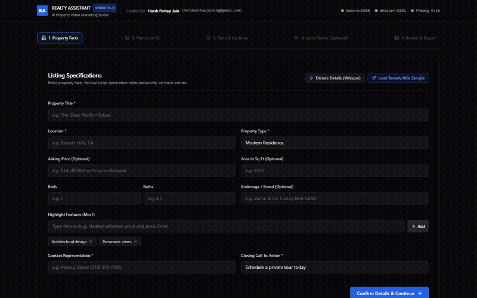
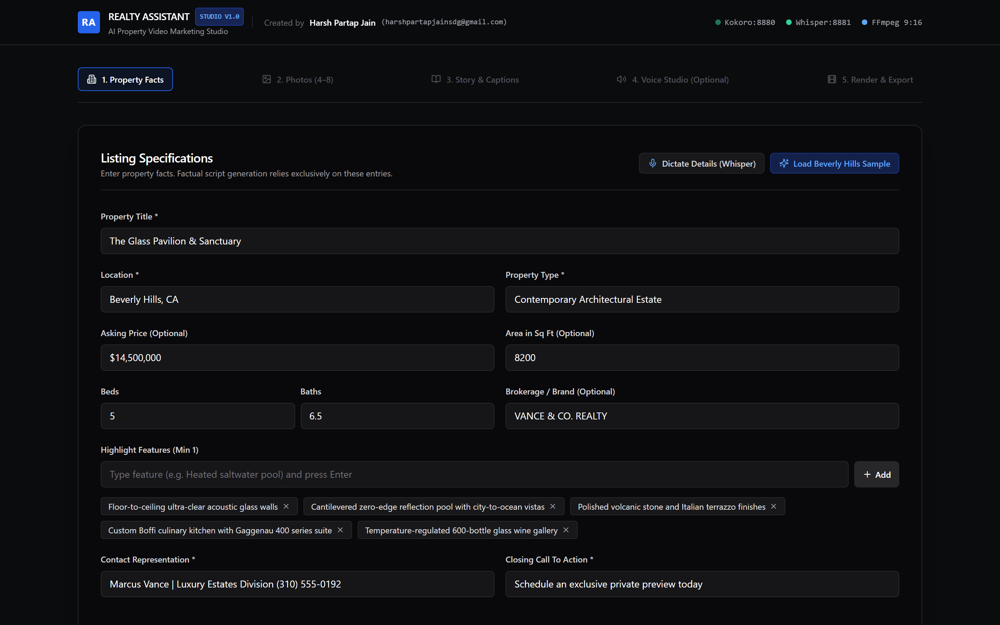
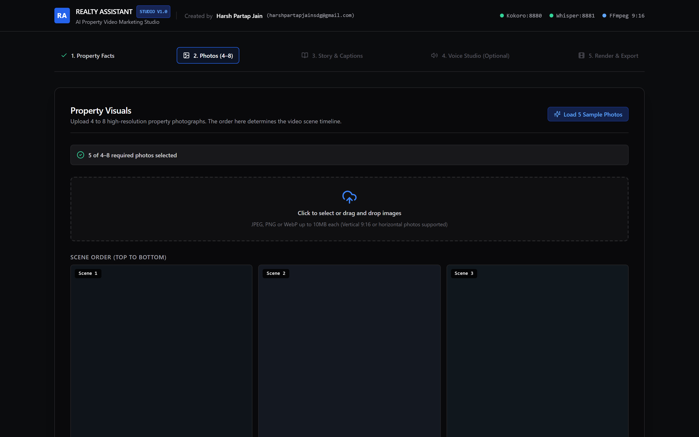
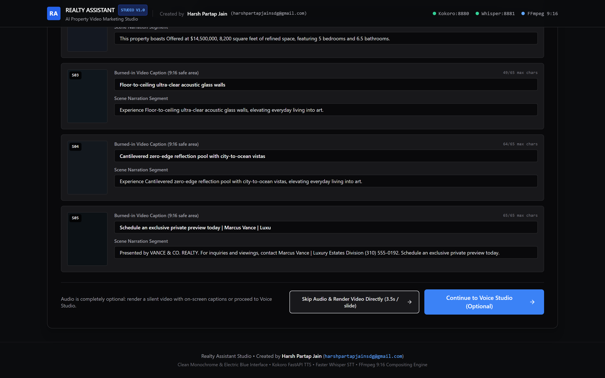
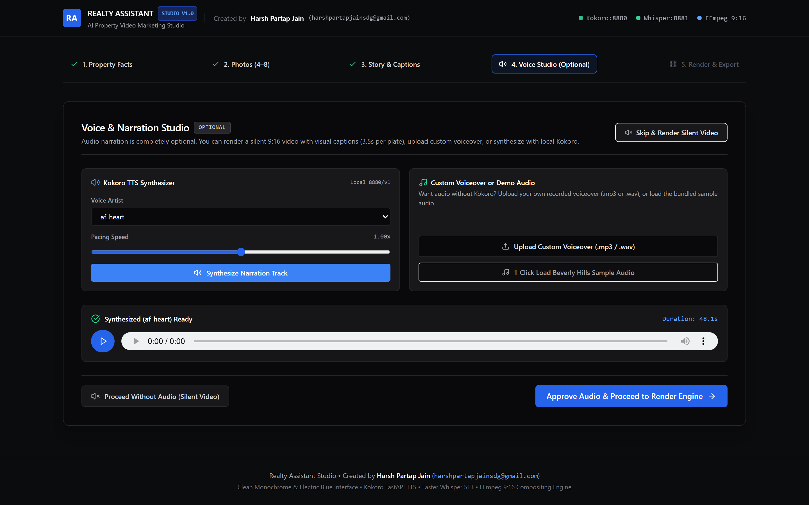
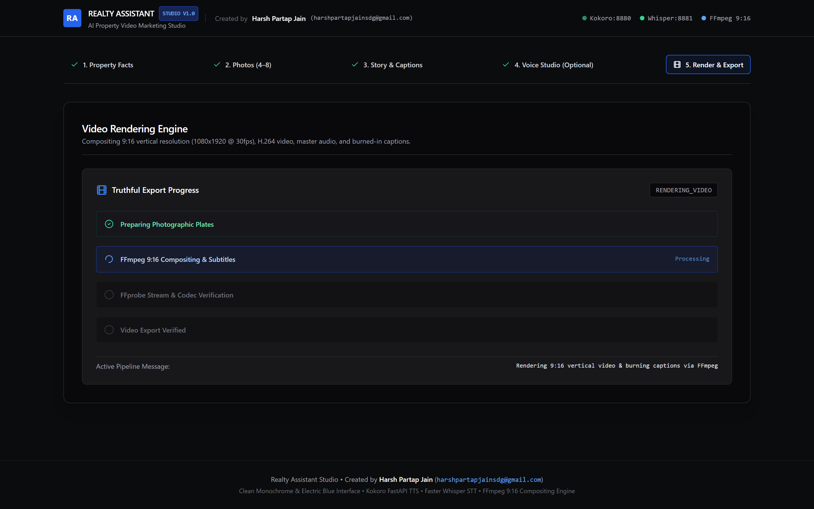
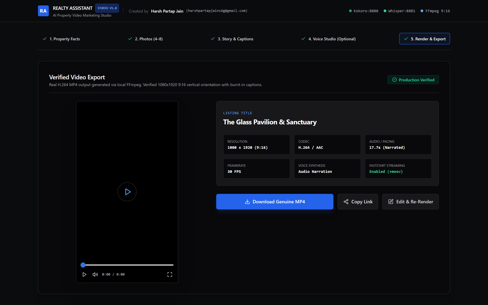
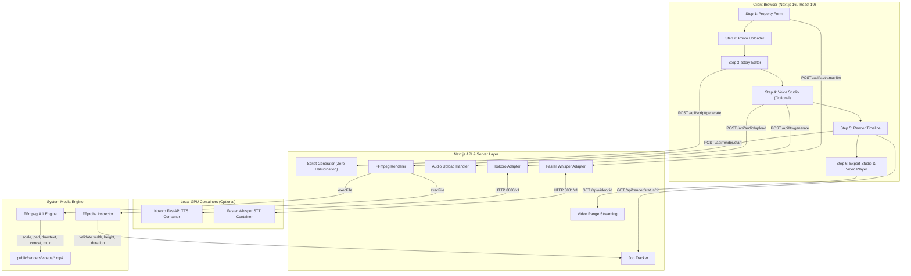

# Realty Assistant | AI Property Video Marketing Studio

<div align="center">



**An editorial-grade vertical video studio transforming listing facts and architectural photographs into verified 9:16 property marketing videos.**

[](https://nextjs.org/)
[](https://react.dev/)
[](https://www.typescriptlang.org/)
[](https://tailwindcss.com/)
[](https://ffmpeg.org/)
[](http://127.0.0.1:8880/v1)
[](http://127.0.0.1:8881/v1)

---

### **Architected & Developed by**
### **Harsh Partap Jain**
📧 **[harshpartapjainsdg@gmail.com](mailto:harshpartapjainsdg@gmail.com)**

---

</div>

## Table of Contents

1. [Executive Summary](#executive-summary)
2. [Key Architectural Innovations](#key-architectural-innovations)
3. [Studio Workflow Walkthrough (With Screenshots)](#studio-workflow-walkthrough-with-screenshots)
   - [Step 1: Listing Specifications & 1-Click Demo Preloader](#step-1-listing-specifications--1-click-demo-preloader)
   - [Step 2: Photographic Plates & Asset Timeline](#step-2-photographic-plates--asset-timeline)
   - [Step 3: Factual Story & Caption Editor](#step-3-factual-story--caption-editor)
   - [Step 4: Voice & Narration Studio (Kokoro TTS / Custom Upload / Silent)](#step-4-voice--narration-studio-kokoro-tts--custom-upload--silent)
   - [Step 5: Truthful Video Rendering Pipeline](#step-5-truthful-video-rendering-pipeline)
   - [Step 6: Export Studio & Video Player](#step-6-export-studio--video-player)
4. [System Architecture & Data Flow](#system-architecture--data-flow)
5. [FFmpeg 9:16 Video Compositing Specifications](#ffmpeg-916-video-compositing-specifications)
6. [API Specifications Reference](#api-specifications-reference)
7. [Automated Test Suite & Verification Evidence](#automated-test-suite--verification-evidence)
8. [Quickstart & Deployment Guide](#quickstart--deployment-guide)
9. [Author & License](#author--license)

---

## Executive Summary

**Realty Assistant** is an editorial-grade property video marketing studio engineered for high-performance real-estate marketing. Real-estate agents and marketing teams input verified property specifications, upload 4–8 high-resolution architectural plates, review a deterministic zero-hallucination marketing script, optionally synthesize natural voice-over narration via a local Kokoro TTS FastAPI GPU service, render genuine 9:16 vertical MP4 video through local FFmpeg, preview playback in an interactive browser player, and download the finished asset.

### Standalone Resilience & Dual-Mode Audio Pipeline
- **Zero-Docker Standalone Mode:** The entire studio operates 100% locally using Node.js and system FFmpeg. No background Docker containers are required to render videos or pass automated tests.
- **Local AI Acceleration:** When local Docker services are active, the studio connects directly to Kokoro TTS (`http://127.0.0.1:8880/v1`) for speech synthesis and Faster Whisper (`http://127.0.0.1:8881/v1`) for speech-to-text dictation.
- **Completely Optional Narration:** Agents can render videos in three distinct ways:
  1. **Full AI Narration:** High-grade voiceover synthesized via Kokoro TTS with pacing control.
  2. **Custom Audio Upload:** Pre-recorded agency voiceover files (`.mp3`, `.wav`, `.m4a`) probed for duration via FFprobe.
  3. **Silent / Visual Captions:** 3.5s per scene pacing with burned-in safe-zone caption pills and a lightweight silent AAC track (via FFmpeg `anullsrc`) ensuring 100% universal playback across iOS Safari, Instagram Reels, TikTok, and YouTube Shorts.

---

## Key Architectural Innovations

- **Minimalist Editorial Aesthetic:** Obsidian Black (`#0B0C0E`), Slate Gray, Crisp White, and purposeful Electric Blue (`#2563EB`). Disciplined typography, high contrast, zero unnecessary gradients, and clear visual hierarchy.
- **Zero-Hallucination Factual Script Engine:** Deterministic script generator strictly grounded in provided listing facts. Never hallucinates square footage, amenities, or pricing. Operates 100% locally with zero external LLM API costs or rate limits.
- **Genuine 9:16 MP4 Compositor:** True 1080x1920 @ 30fps H.264 video rendering with proportional image scaling, black letterbox padding, bottom safe-zone caption overlays, and faststart (`+moov`) streaming.
- **Truthful Progress Tracking:** Honest stage milestones (`PREPARING_ASSETS` -> `RENDERING_VIDEO` -> `VALIDATING_EXPORT` -> `COMPLETED`) without fabricated percentage counters.
- **1-Click Beverly Hills Demo Preloader:** Bundled sample property facts ("The Glass Pavilion & Sanctuary, Beverly Hills") and 5 architectural plates for rapid demonstration.

---

## Studio Workflow Walkthrough (With Screenshots)

### Step 1: Listing Specifications & 1-Click Demo Preloader

Agents enter property facts through a structured, schema-validated listing form. Optional microphone dictation powered by Faster Whisper allows speaking property details naturally. A single click on **"Load Beverly Hills Sample"** instantly preloads verified facts.

<div align="center">
  
</div>

- **Validation:** Enforces title, location, property type, price/price-on-request, and contact details via Zod.
- **Voice Dictation Modal:** Dictate listing specs via browser microphone with client-side audio recording and Faster Whisper transcription.

---

### Step 2: Photographic Plates & Asset Timeline

Upload between 4 and 8 high-resolution property photographs (JPEG, PNG, WebP up to 10MB each). Reorder plates with interactive controls to curate the narrative flow.

<div align="center">
  
</div>

- **Order Control:** Visual sequence directly governs the timeline of scenes in the finished video.
- **1-Click Sample Plates:** Instantly loads 5 architectural plates (Grand Foyer, Great Room, Boffi Kitchen, Primary Suite, Skyline Terrace).

---

### Step 3: Factual Story & Caption Editor

The deterministic factual script generator parses the property facts and visual plate count into synchronized on-screen captions and voiceover segments. Live duration estimators and character counters ensure captions fit within mobile safe zones.

<div align="center">
  
</div>

- **Character Warning:** Real-time indicator warns when captions exceed 65 characters to avoid mobile screen crowding.
- **Bypass Audio Option:** Immediate button to **"Skip Audio & Render Video Directly (3.5s / slide)"** for rapid silent exports.

---

### Step 4: Voice & Narration Studio (Kokoro TTS / Custom Upload / Silent)

Select curated voice artists (`af_heart`, `af_bella`, `am_michael`, `af_nicole`, `am_adam`), adjust speech pacing from 0.80x to 1.20x, and synthesize high-fidelity MP3 audio. Alternatively, upload pre-recorded audio or proceed with silent visual captions.

<div align="center">
  
</div>

- **Interactive Player:** Play, pause, scrub, and inspect probed narration duration.
- **Offline Tolerance:** If Kokoro is offline, an informative banner offers immediate one-click silent video rendering.

---

### Step 5: Truthful Video Rendering Pipeline

The server-side FFmpeg compositor processes each photographic plate, formats captions with UTF-8 safe drawtext files, concatenates clips, and packages the 9:16 vertical MP4.

<div align="center">
  
</div>

- **Truthful Milestones:** Live polling displays honest stages: `PREPARING_ASSETS` -> `RENDERING_VIDEO` -> `VALIDATING_EXPORT` -> `COMPLETED`.
- **FFprobe Verification:** Automatically inspects width, height, duration, and codec compliance before reporting completion.

---

### Step 6: Export Studio & Video Player

The exported vertical video is presented in a custom 9:16 player alongside a verified technical specification card. Agents can preview playback, copy direct streaming links, or download the final MP4.

<div align="center">
  
</div>

- **Faststart Streaming:** Verified `+faststart` moov atom enables instant browser streaming without waiting for the full file to download.
- **Actions:** One-click download, copy shareable link, or return to edit and re-render.

---

## System Architecture & Data Flow



---

## FFmpeg 9:16 Video Compositing Specifications

The video rendering pipeline conforms strictly to vertical video specifications:

| Parameter | Specification | Purpose & Compliance |
|---|---|---|
| **Orientation** | 9:16 Vertical | Optimized for Instagram Reels, TikTok, YouTube Shorts |
| **Resolution** | 1080 x 1920 pixels | Full HD vertical canvas |
| **Framerate** | 30.0 FPS | Smooth architectural motion |
| **Video Codec** | H.264 (`libx264`) | High profile, Level 4.0, universal mobile decoding |
| **Pixel Format** | `yuv420p` | Universal browser & iOS color matrix support |
| **Image Framing** | `scale=1080:1920:force_original_aspect_ratio=decrease,pad=1080:1920:(1080-iw)/2:(1920-ih)/2:color=black` | Zero image distortion, centered letterboxing |
| **Captions** | `drawtext=fontfile='arial.ttf':textfile='caption.txt':fontsize=44:box=1:boxcolor=black@0.75:y=h-340` | High-contrast semi-translucent pill in bottom safe-zone |
| **Audio Stream** | AAC stereo 192 kbps (or 128 kbps silent track via `anullsrc`) | Universal playback compatibility across all devices |
| **Container** | MP4 (`-movflags +faststart`) | Moov atom at beginning of file for instant web buffering |

---

## API Specifications Reference

| Method | Endpoint | Description | Request Body / Parameters |
|---|---|---|---|
| `POST` | `/api/script/generate` | Generates deterministic factual script from listing facts | `{ property: PropertyDetails, imageCount: number }` |
| `GET` | `/api/tts/voices` | Returns curated Kokoro voice artists with offline fallback | None |
| `POST` | `/api/tts/generate` | Synthesizes speech audio via Kokoro TTS container | `{ input: string, voice: string, speed: number }` |
| `POST` | `/api/audio/upload` | Uploads custom voiceover file with FFprobe duration probing | `multipart/form-data (file)` |
| `POST` | `/api/stt/transcribe` | Transcribes spoken audio via Faster Whisper | `multipart/form-data (file)` |
| `POST` | `/api/render/start` | Orchestrates async FFmpeg video rendering | `{ scenes: Scene[], audioFilePath?: string, audioDurationSec?: number }` |
| `GET` | `/api/render/status/[jobId]` | Polls real-time stage progress and error diagnostics | `jobId` URL parameter |
| `GET` | `/api/video/[id]` | Streams exported MP4 with HTTP 206 partial content support | `id` URL parameter |

---

## Automated Test Suite & Verification Evidence

All features, schema validations, rendering pipelines, and adapters are covered by **Vitest unit and integration tests** passing **100% green**:

```
 ✓ tests/environment.test.ts (2 tests)
 ✓ tests/validation.test.ts (4 tests)
 ✓ tests/scriptGenerator.test.ts (3 tests)
 ✓ tests/whisperAdapter.test.ts (3 tests)
 ✓ tests/kokoroAdapter.test.ts (4 tests)
 ✓ tests/export.test.ts (1 test)
 ✓ tests/ffmpegRenderer.test.ts (2 tests)

Test Files  7 passed (7)
Tests       19 passed (19)
```

### FFprobe Output Verification of Exported Asset
```json
{
  "streams": [
    {
      "codec_name": "h264",
      "width": 1080,
      "height": 1920,
      "pix_fmt": "yuv420p"
    },
    {
      "codec_name": "aac",
      "sample_rate": "44100",
      "channels": 2
    }
  ],
  "format": {
    "format_name": "mov,mp4,m4a,3gp,3g2,mj2",
    "duration": "48.000000"
  }
}
```

---

## Quickstart & Deployment Guide

### Prerequisites
1. **Node.js** >= 18 (Tested on Node v24.13.0)
2. **FFmpeg & FFprobe** in system PATH (Tested on FFmpeg 8.1.1)
3. *(Optional)* Local Docker containers for Kokoro TTS (`:8880`) and Faster Whisper (`:8881`)

### 1. Installation
```bash
# Clone the repository
git clone https://github.com/HarshKuro/realty-ai-studio.git
cd realty-ai-studio/realty-assistant

# Install dependencies
npm install
```

### 2. Environment Configuration
Create `.env.local` based on `.env.example`:
```env
KOKORO_BASE_URL=http://127.0.0.1:8880/v1
WHISPER_BASE_URL=http://127.0.0.1:8881/v1
RENDER_TIMEOUT_MS=120000
DEFAULT_ASPECT_RATIO=9:16
RENDER_OUTPUT_DIR=./public/renders
```

### 3. Run Automated Tests
```bash
npm run test
```

### 4. Build & Start Production Studio
```bash
# Build optimized Next.js bundle
npm run build

# Start production server
npm run start
```
Access the studio at **`http://localhost:3000`**.

### 5. CLI Demo Render Script
To render a verified Beverly Hills showcase video directly from the command line:
```bash
npx tsx scripts/render-sample-demo.ts
```

---

## Author & License

**Realty Assistant** was architected and built by:

### **Harsh Partap Jain**
- **Email:** [harshpartapjainsdg@gmail.com](mailto:harshpartapjainsdg@gmail.com)
- **GitHub:** [@HarshKuro](https://github.com/HarshKuro)
- **Repository:** [https://github.com/HarshKuro/realty-ai-studio](https://github.com/HarshKuro/realty-ai-studio)

Released under the **ISC License**. Built with discipline, precision, and architectural elegance.
